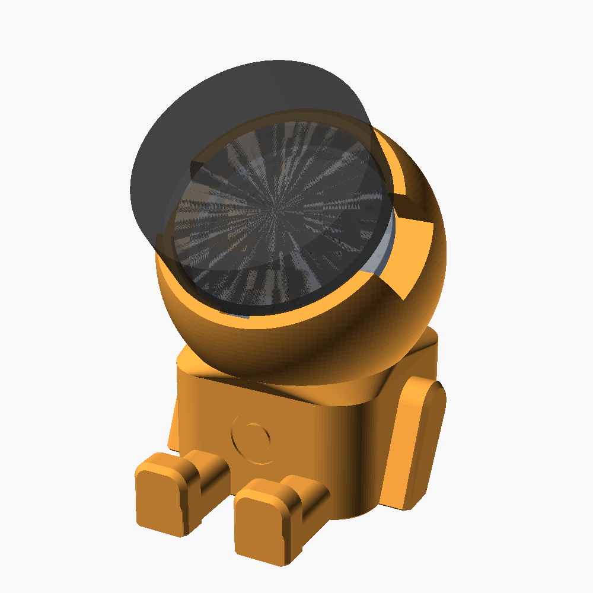
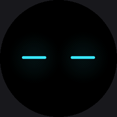
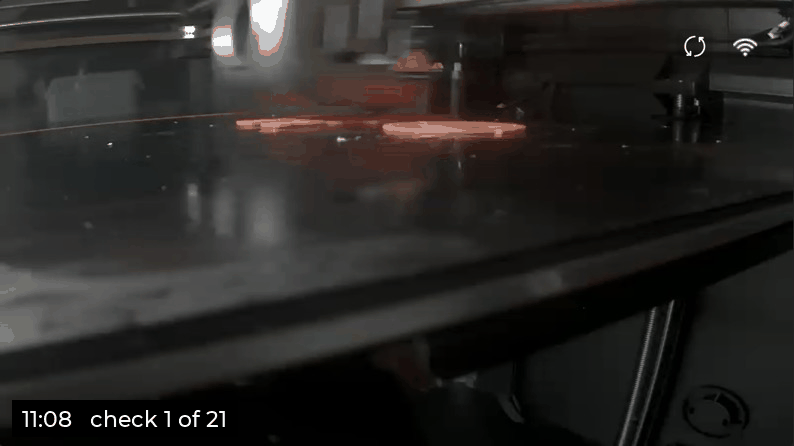
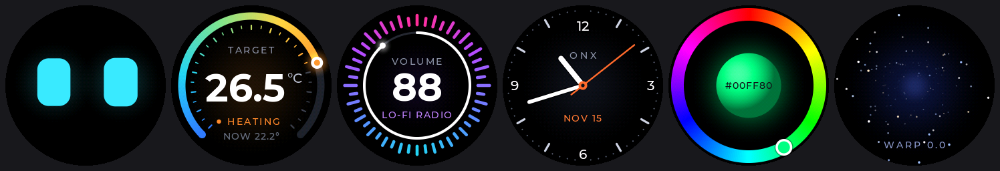

# A desk robot for the ONX2424G013 round knob display

3D-printable holders for the Open Nextion ONX2424G013, a 1.28 inch round ESP32-S3 display with a knob around it, and a demo firmware that gives it a face.

The one that got built is a one-piece robot: the display is its face, it prints in 1 hour 26 minutes with no supports, and the display drops in and lifts out by hand.

| The robot (CAD render) | Its face (simulator render) |
|---|---|
|  |  |



*The print on 12 November 2026: 21 looks through the printer's camera, four minutes apart.*

## What is here

| Folder | What it is | Printed? |
|---|---|---|
| [`designs/robot-onepiece/`](designs/robot-onepiece/) | One-piece desk robot. **Start here** | Yes, once |
| [`designs/robot-articulated/`](designs/robot-articulated/) | Posable robot with clicking joints | No |
| [`designs/robot-desk-seat/`](designs/robot-desk-seat/) | Base that either robot clips onto | No |
| [`designs/desk-stand-cc1101/`](designs/desk-stand-cc1101/) | Tilted stand with room for a 433 MHz radio | No |
| [`designs/panel-puck/`](designs/panel-puck/) | Flat cup for panel or wall mounting | No |
| [`firmware/`](firmware/) | Showcase demo: six animated scenes driven by the knob | Runs on the device |
| [`docs/`](docs/) | The full story, facts, hardware notes and video planning | |

Every design is one OpenSCAD file with ready-made STLs beside it.

## Print the robot

1. Print [`designs/robot-onepiece/robot_onepiece_print.stl`](designs/robot-onepiece/robot_onepiece_print.stl) as it is: robot and mount plate on one bed. Stock 0.2 mm profile, 2 walls, 15 % infill, **supports off**. About 45 g of PLA.
2. Screw the plate to the back of the display with three M1.6 x 4 screws (Nextion supplies four).
3. Thread a USB-C cable up through the body, plug it in, and drop the display into the head.

Details, hardware list and what to do if something does not fit: [`designs/robot-onepiece/README.md`](designs/robot-onepiece/README.md).

**It fits.** On the first print the plate matched the display's holes and the knob presses freely, with the default settings. If yours differs, the plate is the only part to reprint: see the design's README.

## Flash the demo



Turn the knob to play with a scene, press for the next one, hold for a second to rotate the picture. Left alone for 15 seconds it plays by itself.

```bash
./firmware/tools/backup_factory.sh my_backup
```

```bash
./firmware/onx_showcase/build.sh flash
```

The first command saves the firmware the display shipped with. The second builds and uploads the demo with `arduino-cli`. More in [`firmware/README.md`](firmware/README.md).

## The story

- [`docs/ARTICLE.md`](docs/ARTICLE.md): how it was designed, printed and programmed, including what went wrong.
- [`docs/PROJECT_LOG.md`](docs/PROJECT_LOG.md): timeline and every number, marked as measured, calculated or unknown.
- [`docs/HARDWARE.md`](docs/HARDWARE.md): pins and facts about the display.
- [`docs/VIDEO_BRIEF.md`](docs/VIDEO_BRIEF.md): planning notes for a video.
- [`AGENTS.md`](AGENTS.md): notes for AI assistants working in this repository.

This project was built with an AI coding assistant (Claude Code), which wrote the CAD and firmware, ran the slicer and watched the print. It never saw the real parts or the real screen. The images of the demo in this repository are rendered by a simulator from the firmware's own code; the only real images here so far are the slicer screenshots and printer camera frames in `docs/media/print/`. Video of the finished robot exists but is not in this repository yet.

## Not included

Nextion's drawings, schematic and factory firmware are theirs and are not redistributed here. Get the drawings from Nextion. Their ESPHome example for this board is at <https://github.com/opennextion/OpenNextion-Example-ESPHome_KNOB_Control>.

## Licence

MIT. The font tables in the firmware are rasterised from Montserrat (SIL Open Font License). See [LICENSE](LICENSE).
