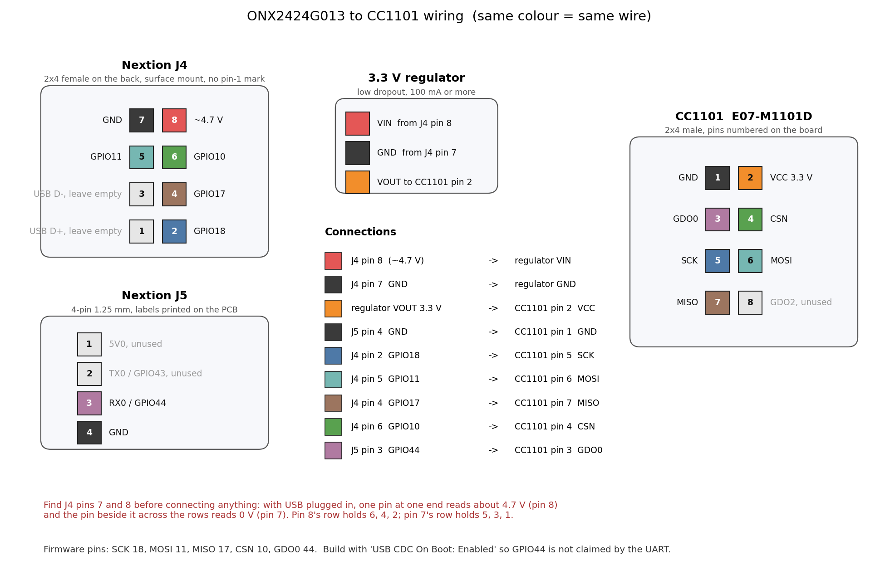

# ONX2424G013 desk stand with CC1101 433 MHz radio

**Status: designed and checked in CAD, never printed.** The radio wiring is also untested on hardware.

> **Correction, 11 Nov 2026.** Every STL exported before this date was a mirror image of what the display needs. Positions were copied from Nextion's back-view drawing without mirroring them for a part that mates with the back. The model now mirrors all parts at output (`mirror_fix = true`) and the STLs here are re-exported. Consequences: the SMA jack is now on the **left** side and the USB cable notch at the back **right**, seen from the front. Discard any part printed from the older files. `hole_template.pdf` is still correct: it is a back view, held against the back.

One OpenSCAD file, `onx2424g013_base_case.scad`, with a `part` selector:

| part | what it is | file |
|---|---|---|
| `stand` | hollow tilted shell: module pocket on top, CC1101 inside, SMA jack out of the left side | `onx2424g013_stand.stl` |
| `base` | screw-on bottom plate: keyholes, feet, and the tongue that locks the SMA | `onx2424g013_base.stl` |
| `case` | flat puck for panel / wall mounting (no room for the radio) | [`../panel-puck/onx2424g013_base_case.stl`](../panel-puck/) |
| `assembly` | preview with ghosts of the module, plugs, radio and antenna | – |

    openscad -D 'part="stand"' -o onx2424g013_stand.stl     onx2424g013_base_case.scad
    openscad -D 'part="base"'  -o onx2424g013_base.stl      onx2424g013_base_case.scad
    openscad -D 'part="case"'  -o ../panel-puck/onx2424g013_base_case.stl onx2424g013_base_case.scad

Set `radio=false` to build the same stand without the SMA slots and tongue.

## Is the CC1101 feasible? Yes, with a 3.3 V regulator
The module in the Amazon listing is a clone of the Ebyte E07-M1101D: CC1101 transceiver, SPI, 1.8–3.6 V, +10 dBm, edge-mount SMA, 2x4 male header. The board is labelled 433M, so its RF matching is for 433 MHz only, whatever the listing title says.

What the Nextion offers (from its schematic, pages 4 and 5):

| Connector | Pin | Signal | Use |
|---|---|---|---|
| J4 2x4 | 1 | USB D+ (GPIO20), shared with the USB-C port | leave empty |
| J4 | 3 | USB D− (GPIO19), shared with the USB-C port | leave empty |
| J4 | 2, 4, 5, 6 | GPIO18, GPIO17, GPIO11, GPIO10 | SPI to the CC1101 |
| J4 | 7 | GND | regulator GND |
| J4 | 8 | VCC_SYS = USB 5 V after a Schottky diode, about 4.7 V | regulator input only |
| J5 1.25 mm | 1, 2 | 5V0, TX0 (GPIO43) | unused |
| J5 | 3 | RX0 (GPIO44) | CC1101 GDO0 |
| J5 | 4 | GND | CC1101 GND |

- **No 3.3 V is brought out.** The CC1101's absolute limit is 3.9 V, so J4 pin 8 must go through a 3.3 V regulator. Use a low-dropout type (HT7333, MCP1700, XC6206, ME6211 or AP2112 based, 100 mA or more). An AMS1117 board usually works but needs about 4.4 V in, which leaves almost no margin on 4.7 V.
- **Five signals are enough.** SCK, MOSI, MISO and CSN use the four clean J4 GPIOs; GDO0 uses GPIO44 on J5. GDO2 is not needed.
- **The pin order does not match**, so the CC1101 cannot plug straight into J4. Use Dupont jumpers (male end into J4, female end onto the CC1101) and a 1.25 mm 4-pin pigtail for J5.
- **Current** is about 30 mA while transmitting, well within USB power.
- **UAE rules (TDRA short-range devices):** 433.05–434.79 MHz is licence-exempt at up to 10 mW e.r.p. and 10 % duty cycle. The CC1101's maximum is +10 dBm (10 mW), and a stubby antenna has gain below 0 dBi, so 433.92 MHz at default power is within the limit. Do not use 315 or 915 MHz.
- **What it can control:** fixed-code 433 MHz devices (plug sockets, doorbells, many simple remotes). Rolling-code remotes such as most car and modern gate remotes cannot be reproduced by recording and replaying.

### Finding J4 pin 1
J4 is a surface-mount socket with no pin-1 mark. With USB plugged in, measure the pins at both ends of the socket: one end has a pin at about 4.7 V (pin 8) with the pin across the rows at 0 V (pin 7). The row containing pin 8 continues 6, 4, 2; the row containing pin 7 continues 5, 3, 1. Do this before connecting anything.

### Firmware
- Pins: SCK 18, MOSI 11, MISO 17, CSN 10, GDO0 44.
- Arduino: set *USB CDC On Boot: Enabled* so `Serial` uses native USB and GPIO44 is free.
- Libraries: RadioLib supports the CC1101 on its own `SPIClass` (use a second SPI host so it cannot clash with the display driver). For fixed-code 433 MHz remotes, SmartRC-CC1101-Driver-Lib plus rc-switch is the common route; it uses the default `SPI` object, so check it does not fight the display driver for the same SPI host.

## The one mechanical rule
Only the Ø43.27 base of the module may touch the print. The knob overhangs it by 2.37 mm per side and must stay free. The pocket rim stays 1.5 mm (`press_gap`) below the knob.

## Stand design
30° tilt, 56 × 51 mm footprint, 23 mm high at the front, 53 mm at the back. The height is set automatically so the USB plug and the J4 Dupont housings clear the base plate with 6 mm for the wires to bend.

- **Pocket** Ø44.27 × 6.9 mm. The module rests on a 2.6 mm ledge and on three pads under its screw bosses. The middle is open so the USB plug, the J4 jumpers and the J5 pigtail pass straight down into the shell.
- **Printable hollow shell.** A flat ceiling under a 30° roof cannot print without supports, so the inside of the roof is made of 45° ridges running up the slope (about 52° in print). Printed open side down, the shell needs no supports; the only bridges are the cable notch, the flange slot top and the Ø4 screw-channel ends.
- **CC1101 bay.** The board stands on edge near the back wall, components facing the wall, header toward the middle, SMA pointing out of the left side. The square SMA flange slides up into a slot in a thickened section of the side wall: walls on both sides, a 1.2 mm keeper behind it with a slit for the board, and 1.6 mm of skin in front. The base plate's tongue closes the slot from below. The jack is therefore held in every direction, and screwing the antenna on and off loads the plastic, not the CC1101's solder joints. 5.4 mm of thread sticks out for the antenna nut.
- **Module screws.** Three M1.6 × 4 or × 5 through 2 mm pads. Two are reached from underneath with the base plate off. The rear one is reached through the small angled hole in the back wall.
- **Base plate.** Four M3 × 8 flat-head self-tapping screws into bosses in the shell, heads hidden under 9 mm stick-on feet. Three keyhole slots for #6 / M3.5 pan-head screws: fit the screws to the desk or wall with the heads about 2.5 mm proud, drop the stand over them and push it backwards. Or just use double-sided tape on the flat underside.
- **Cables.** USB-C leaves through the notch at the back right. The antenna is on the left side. (Left and right as seen from the front.)

### Shopping list
- 3.3 V low-dropout regulator module.
- 6 male-to-female Dupont jumpers, about 10 cm, for J4 (male end into J4).
- 1 female-to-female jumper from the regulator's VOUT pin to CC1101 pin 2 (if the regulator board has header pins; otherwise solder).
- 1.25 mm 4-pin pigtail for J5 (Molex PicoBlade-compatible, often sold as "MX1.25 4P" or "JST 1.25"), ideally with Dupont female ends; only pins 3 and 4 are used.
- M1.6 × 4 or × 5 screws (Nextion supplies four).
- 4 × M3 × 8 flat-head self-tapping screws, 4 × 9 mm stick-on feet.
- Optional: a hinged 433 MHz SMA antenna, so it can point straight up. The stubby one in the listing will stick out sideways.

### Assembly order
1. Find J4 pins 7 and 8 with a meter (see above).
2. Plug the jumpers into J4 and the pigtail into J5. Plug the USB-C cable into the module.
3. Feed the cable, jumpers and pigtail down through the pocket and into the shell. Seat the module in the pocket.
4. Fit the three M1.6 screws: two from underneath, the rear one through the hole in the back wall.
5. Wire the regulator and the CC1101 (diagram above). Heat-shrink the regulator and stick it with foam tape to the inside of the right wall, between the USB plug and the wall.
6. Push the CC1101 up into its seat from below: SMA thread into the side slot, flange into its pocket.
7. Route the USB cable through the back notch. Fit the base plate: its tongue slides up under the SMA. Fit the four M3 screws and the feet.
8. Screw on the antenna.

To take it apart, reverse the order: the CC1101 has to come out before you can reach the rear M1.6 screw.

## Check before printing
1. Print `hole_template.pdf` at 100 % and hold it on the back of the module, printed side toward you. It checks the dimensions of Nextion's drawing. The model does the mirroring for the mating parts itself.
2. Measure the knob's push travel; `press_gap` (1.5) must be larger.
3. **Measure your CC1101 board.** `rf_board` defaults to 30 × 16.5 × 1.6 mm (Ebyte says 15 × 30; the listing says 28 long). Length matters most: it sets where the header end sits.
4. **Measure the SMA:** flange size and thickness (`rf_flange`, default 7 × 2), length from board edge to thread tip (`rf_sma_len`, 9), and whether the jack's axis sits on the board's mid-plane or on its top surface (`rf_sma_off`, 0.8 toward the component side). If the axis is off, the flange will not line up with its slot.
5. Measure your USB-C plug length from the module's back to the end of the strain relief (`plug_len`, 25).

## Verification done in OpenSCAD
Each pair below was intersected; an empty result means no collision.

| Check | Result |
|---|---|
| Shell vs module, USB plug, J4 Dupont block, J5 plug | contact only (module sits on its ledge) |
| Base plate vs module and plugs | clear |
| Shell vs CC1101 board, header, Dupont housings, SMA | clear |
| Base plate vs CC1101 | clear |
| CC1101 vs module and its plugs | clear |
| Antenna vs shell | clear |
| CC1101 pieces swept 14 mm up into the seat vs shell | clear |
| 6 mm wire-bend zone under the J4 jumpers vs base plate | clear |
| Shell vs base plate above the seam | clear |
| Overhang scan of both STLs | no surface worse than 45° except small bridges |

Still assumptions: the J4/J5 footprints (±0.5 mm from the drawing), the module hole pattern (drawing only), the push travel, and the CC1101 and SMA dimensions listed above.

## Panel puck
Unchanged: Ø48.27 × 13.4 mm, flush with the knob, USB-C through an 8 × 14 mm floor hole, two M3 bosses for mounting from behind a panel. It has no room for the radio; for a panel install, mount the CC1101 behind the panel with an SMA bulkhead pigtail.
