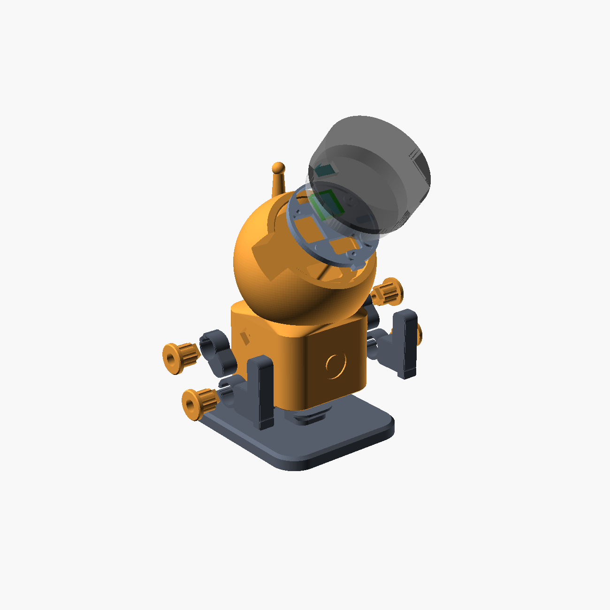

# Posable desk robot for the ONX2424G013

The round knob display is the robot's face. The legs click between standing and sitting, the arms click full circle in eight positions, and the USB-C cable runs inside the body. **Status: never printed.** The design is checked in CAD only, so print the small test set first. It was set aside for the simpler [one-piece robot](../robot-onepiece/), which is the version that was built.

Source: `onx2424g013_robot.scad`. Preview with `part = "assembly"` and `pose = "sit"` or `"stand"`.

| Part | File | Qty | How to print |
|---|---|---|---|
| Body (ball head, rounded-box torso, backpack) | `robot_body.stl` | 1 | As exported, standing. Supports off. 0.2 mm layers, 3 walls, 15 % infill |
| Leg | `robot_leg.stl` | 2 | Flat. Left and right are the same part, one flipped over. 4 walls |
| Arm | `robot_arm.stl` | 2 | Flat. 4 walls |
| Hub (joint pin) | `robot_hub.stl` | 4 | Cap on the bed, stem up. 4 walls |
| Mount plate | `robot_plate.stl` | 1 | Flat side down |
| Desk seat (optional) | `robot_seat.stl` | 1 | As exported, flat. No supports. See [`../robot-desk-seat/`](../robot-desk-seat/) |
| Test set: plate, one hub, joint test piece | `robot_test_set.stl` | 1 | Print this before anything else |

About 81 g of filament for the robot. Sitting, it is 105 mm tall to the top of the knob; standing adds 14 mm. The head is 64 mm across, the torso 49 mm, and the robot is 71 mm wide over the joint caps.

## Printing
Every part prints without supports. Turn supports off in the slicer: it may otherwise add them to the screw holes and the shallow chest ring, where they are not needed and are hard to remove.

**Small parts (legs, arms, hubs, plate): easy.** They are flat shapes with no overhangs. Edges that touch the bed are chamfered so first-layer squish does not tighten the joints or the plate.
- Print the four hubs together so each layer has time to cool.
- PETG is the better material for the legs and arms: their split rings flex at every click, and PLA is more likely to crack there over time. PLA works to start with.

**Body: moderate.** It is a 103 mm tall, roughly 6 hour print with a full flat base on the bed, so adhesion is not a concern.
- No surface overhangs by more than 40 degrees, apart from about 2 cm2 of small features: the roofs of the joint recesses, the cable slot and the 2.6 mm screw holes. There are no flat ceilings and no bridges.
- About 48 cm2 overhangs by 30 to 40 degrees. Roughly half of that is the hidden ceiling inside the torso; the visible part is the underside of the ball head and the roof of the display pocket. These print cleanly with the part fan at full power, but expect the underside of the head to look slightly rougher than the top. Slow the outer wall to about 30 mm/s if yours curls.
- The display pocket is printed tilted, so its floor is finely stepped. The plate sits flat on it; the 0.6 mm radial clearance allows for a slightly rough roof.
- The antenna is a thin pin at the very top. It prints, but it is the one fragile feature. Set `antenna = false` if you would rather not have it.
- Put the seam at the back.

## Hardware
- 3 x M1.6 x 4 or x 5 screws (Nextion supplies four with the display)
- 4 x M3 x 12 screws, countersunk or pan head up to 6 mm across, one per joint
- 4 x stick-on rubber feet for the flat underside. They matter: see "Pressing the knob"
- Optional: 4 x disc magnets 6 x 2 mm and a drop of glue

## How the display mounts
1. **Plate onto the display, once.** The side with the raised rim faces the display. The rounded opening goes over the USB-C socket. Fit the three M1.6 screws from the flat side; their heads sink into the counterbores.
2. **Into the head.** The lug on the plate goes down, toward the robot's chin. It drops into a keyway that stops the display turning when you rotate the knob. The face looks up at 50 degrees, so gravity seats it; the magnets add a snap.
3. **Out again.** Pinch the display's fixed base through the two slots at the sides of the face, pull it out and unplug the cable. No tools.

Only the display's fixed base touches the print. The pocket rim stops 1.5 mm below the knob, so the knob rotates and presses freely.

The USB-C socket ends up at the chin, so the picture will probably be turned a quarter turn relative to the robot. Rotate the user interface in firmware; for the GC9A01 display driver that is one setting.

**Magnets (optional).** Glue two into the holes in the pocket floor. Drop the other two on top of them so they orient themselves, put a dab of glue on each, and press the plate down onto them. That guarantees the polarity is right.

## Cable
Push the plug up through the opening in the underside, into the channel in the head, until it sticks out of the pocket. Plug it into the display, lower the display in and pull the slack back down. Lay the cable into the slot at the bottom of the backpack, then press it upward: the slot narrows toward the top and grips cables from 2.5 to 6 mm. The grip keeps tugs on the cable from reaching the display, and it stops the plug sliding back into the head when you take the display out.

The channel takes plugs up to 13.5 x 7.5 mm (`chan`). The path from pocket to backpack is a straight line, so stiff cables are fine.

## Joints
Each joint is a hub pin, a limb and one screw.

- The hub's square end sits in a diamond-shaped recess in the body and is clamped by an M3 x 12 screw. The limb turns on the hub and never touches the screw, so posing cannot loosen it.
- The limb's eye is a split ring with two teeth. They click into 8 notches on the hub, 45 degrees apart. Each tooth is rounder than its notch, so it wedges on the notch's two edges and the limb sits without play.
- Assemble: push the hub through the limb, seat the square end in the recess, fit the screw. Legs go on the lower joints with the foot pointing forward.

| Limb | Positions |
|---|---|
| Legs | Down (stand), 45 degrees, forward (sit) |
| Arms | All eight, full circle, including straight up beside the head |

**Stiffness.** How hard a joint clicks depends on the ring's thickness, cubed, and on your printer's tolerances. I calculate about 0.1 N·m to move a leg and half that for an arm with the defaults (`leg_ring_t` 1.6, `arm_ring_t` 1.2), but treat that as a starting point. The test piece has three eyes, marked with 1, 2 and 3 notches, at 1.2, 1.6 and 2.0 mm. Try each on the test hub, pick what feels right, and set the two values before printing the limbs. If every eye binds on the hub, raise `bore_r` (5.2) by 0.1.

## Pressing the knob
- **Sitting** is the working pose. The backpack reaches 40 mm behind the body's centre, and a press on the knob is aimed at a point 51 mm behind it, so the robot would need to weigh under about 50 g to tip back. Printed parts plus display come to roughly 110 g.
- **It will slide without rubber feet.** A press pushes the robot backward with about two thirds of the press force. Bare PLA on a desk does not grip enough; rubber feet do.
- **Standing** is a display pose. Turning the knob is fine. Pressing it tips the robot backward over its heels, so put a finger behind the head when you press.

## Desk seat (optional)
A flat base, 68 x 82 x 6.5 mm, that stays on the desk while the robot comes and goes. The body needs no changes: the seat uses the opening already in the robot's underside.

- **Fix the seat to the desk** one of three ways: double-sided tape, rubber feet, or three #6 / M3.5 pan-head screws in the keyhole slots (leave the heads about 2.5 mm proud, drop the seat over them and push it back).
- **Clip the robot on:** legs forward, lower it so the raised island enters the opening underneath, then slide it back about 5 mm. It stops hard and the back drops with a click as two pins enter the opening's rear corners.
- **Take it off:** lift the backpack a millimetre or two and slide the robot forward, then lift.
- **What it holds.** Pressing the knob pushes the robot into the hard stop, and the hook at the front stops it tipping back, so the seat removes the need for rubber feet under the robot. Sideways knocks and twisting are blocked by the island. It does not resist a strong pull up and forward: steady the body with a finger when you pull the display off its magnets.
- **Cable.** It leaves through the backpack slot as before and drops into the groove at the back of the seat.
- The robot sits on the seat with its legs forward only. With rubber feet alone, without tape or screws, the seat is still stable against a knob press because it extends 50 mm behind the body's centre.

## Print this first (about 30 minutes)
`robot_test_set.stl` holds the mount plate, one hub and the joint test piece. They test everything that depends on measurements I could not verify:
1. **Plate against the display.** Check the three holes and the connector openings on the back of the display. If the pattern is a mirror image, set `flip_pattern = true` and reprint the plate; nothing else changes, because the USB-C sits on the robot's centre line.
2. **Joint stiffness.** See "Joints". The hub and the plate from this set are good to use in the robot.
3. **Push travel.** Measure how far the knob moves when pressed and check it is under `press_gap` (1.5 mm).

## What was checked in CAD
| Check | Result |
|---|---|
| Body vs plate, display, knob, plug and 30 mm of straight cable | clear |
| Display, plate and plug pulled 45 mm straight out of the pocket | clear |
| Plug channel inside the outer skin | yes |
| Plate vs the display's connectors and the plug | clear |
| Hubs in their recesses; limbs on hubs at every click position | clear |
| Legs at 0, 45, 90 degrees vs body | clear |
| Arms at all 8 angles vs body and head | clear |
| Arms at all angles vs legs at all angles and the hip joints | clear |
| Sitting: legs and arms vs the desk | clear (legs by 0.8 mm) |
| Knob with 1 mm margin vs raised feet and arms | clear |
| Seat: robot set down, slid back in four steps, and locked | clear |
| Seat locked: robot pushed back, forward, sideways, or lifted at the front | blocked in each direction |
| Seat vs legs forward, arms at all angles, plug and cable | clear |
| Overhang scan of all five parts | see "Printing" |

## Still assumptions
- Hole pattern and connector positions come from Nextion's drawing only.
- The knob's push travel and the display's weight are not published.
- Joint stiffness is calculated, not measured. The test piece is there to settle it.
