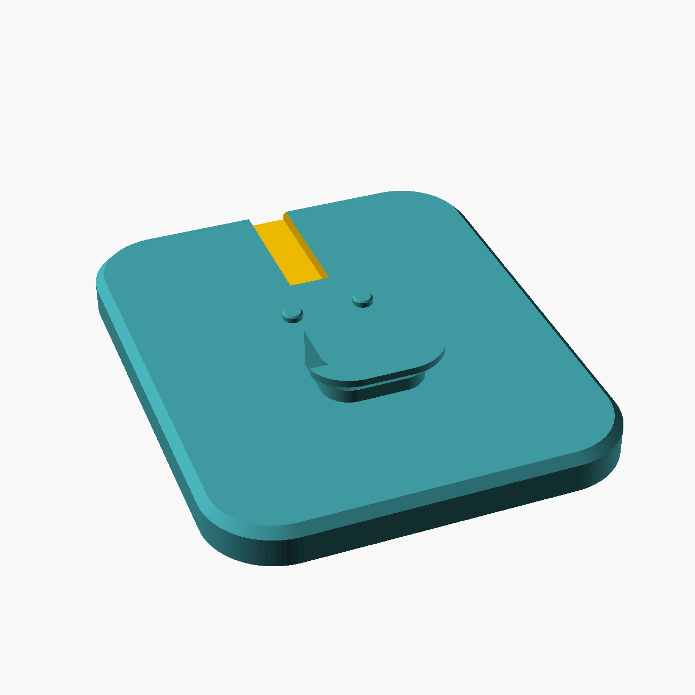
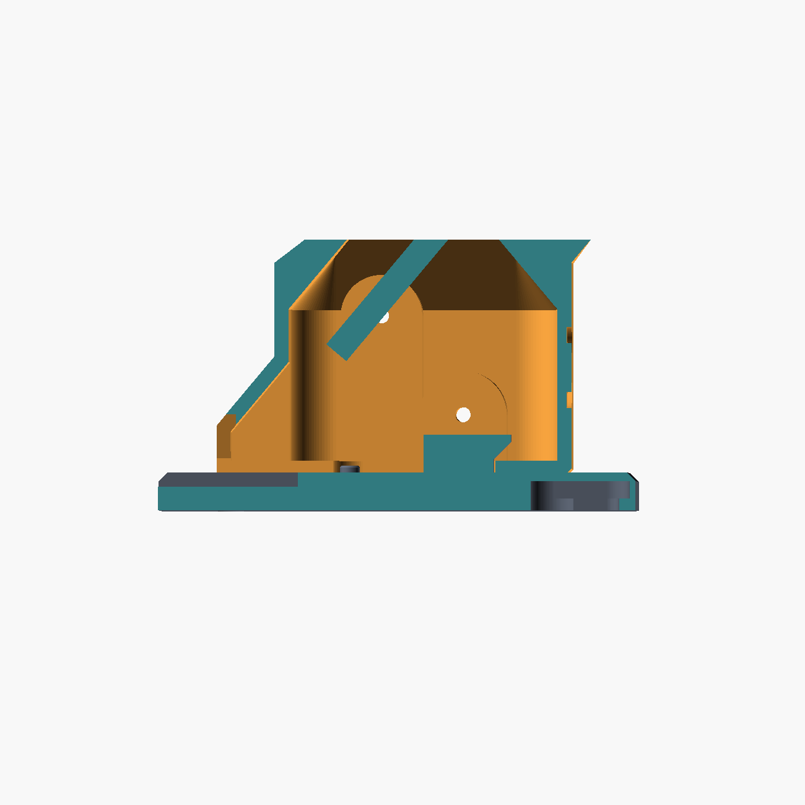
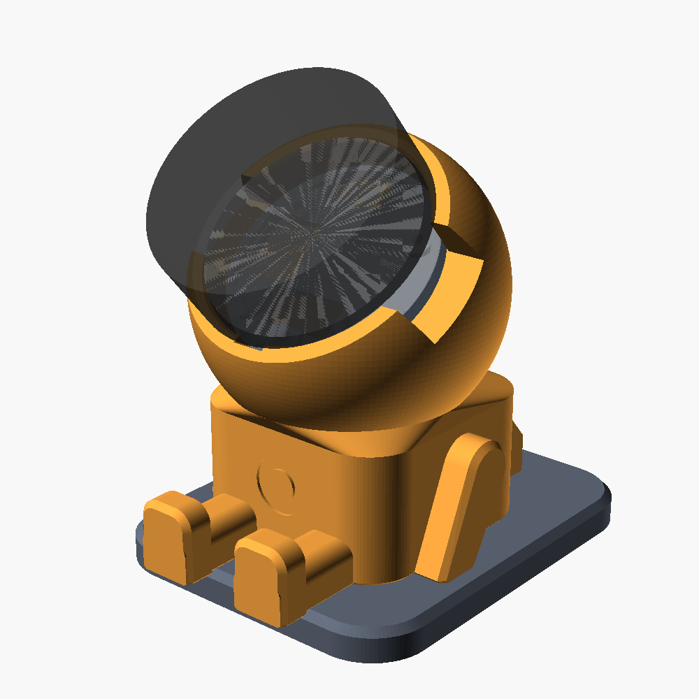

# Desk seat for the robots

**Status: designed and checked in CAD, never printed.**

An optional flat base, 68 x 82 x 6.5 mm, that stays on the desk while the robot comes and goes. It fits both the [one-piece robot](../robot-onepiece/) and the [posable robot](../robot-articulated/), because it uses the cable opening both have in their underside.

- **Fix it to the desk** with double-sided tape, rubber feet, or three #6 / M3.5 pan-head screws in the keyhole slots.
- **Clip the robot on:** lower it so the raised island enters the opening underneath, then slide it back about 5 mm. It stops hard, and two pins click into the opening's rear corners.
- **Take it off:** lift the back a millimetre or two, slide forward, lift.
- **Why:** pressing the knob pushes the robot backward. On the seat it pushes into a hard stop instead of sliding.

| File | What it is |
|---|---|
| `robot_seat.stl` | The seat. Print flat, no supports |

Source: `part = "seat"` in either robot's OpenSCAD file.

    openscad -D 'part="seat"' -o robot_seat.stl ../robot-onepiece/onx2424g013_robot_onepiece.scad
