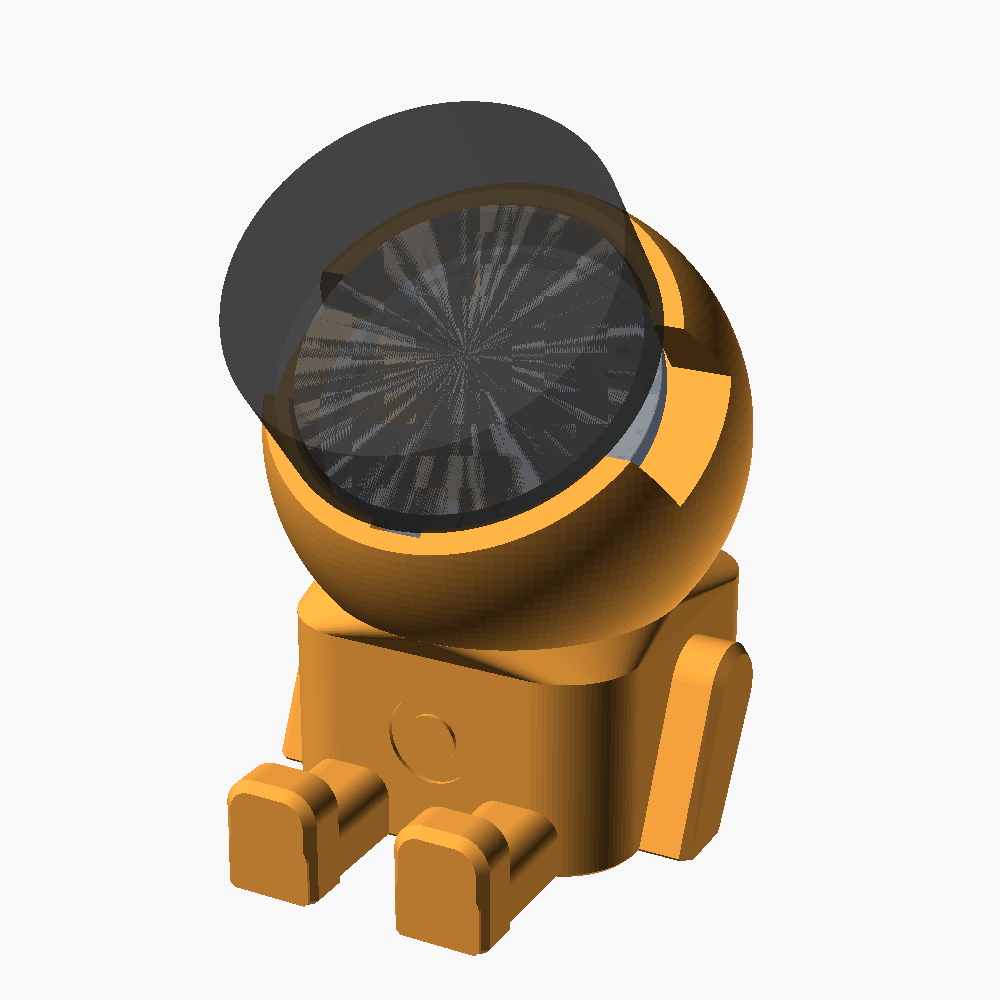
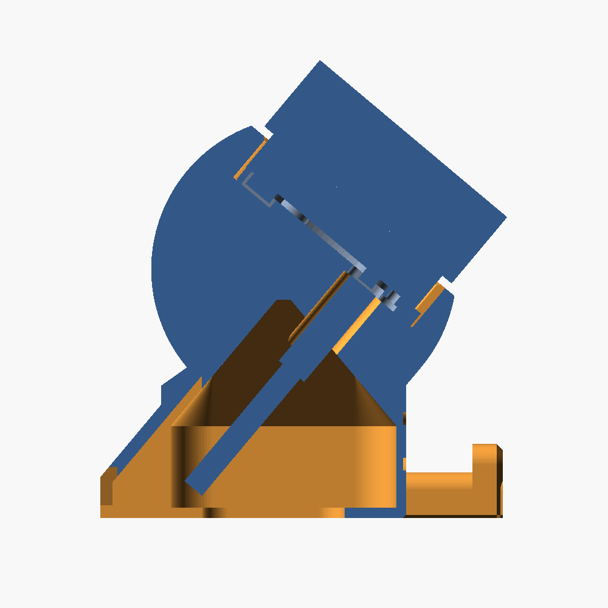
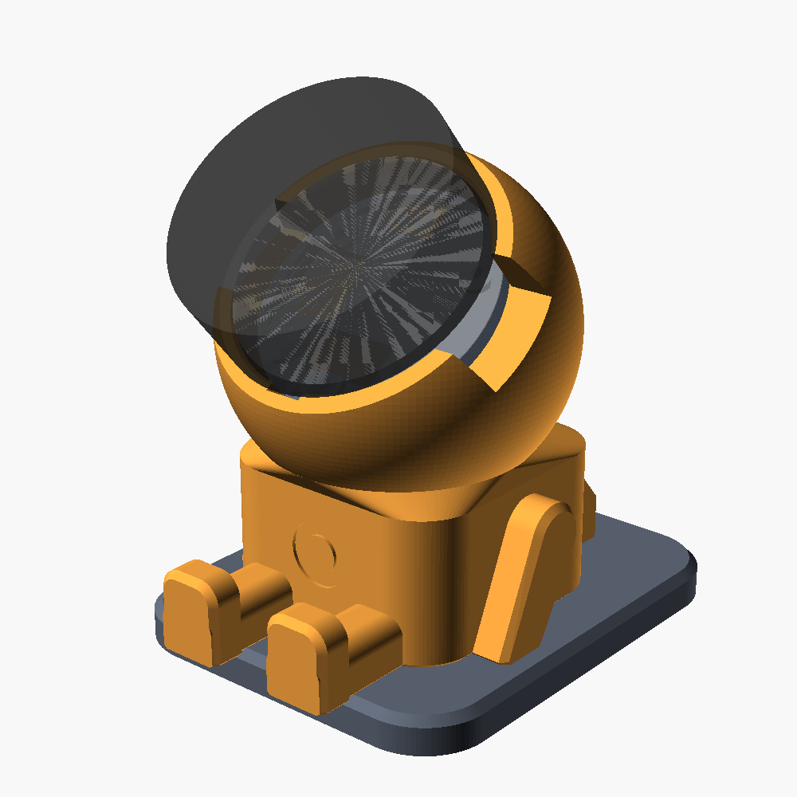

# One-piece desk robot for the ONX2424G013

The round knob display is the robot's face. The robot is a single solid print: it sits with its legs forward and its hands on the desk, and nothing moves or needs assembling. **Status: printed once**, on 2026-11-12, on a Creality K1 Max in red PLA. The print completed cleanly, **the plate fits the display and the knob presses fine** (reported by the owner on 2026-11-17, with the default settings). The demo firmware that gives it a face is in [`../../firmware/`](../../firmware/).

Source: `onx2424g013_robot_onepiece.scad`. Preview with `part = "assembly"`.

| File | What it is |
|---|---|
| `robot_onepiece_print.stl` | **The print job.** Robot and mount plate side by side, as they go on the bed |
| `robot_onepiece.stl` | Robot alone |
| `robot_plate.stl` | Mount plate alone, in case it needs a reprint |
| `robot_seat.stl` | Optional desk seat. Separate print. Also in [`../robot-desk-seat/`](../robot-desk-seat/) |

The earlier posable version, with clicking joints, is kept in [`../robot-articulated/`](../robot-articulated/). Its mount plate and seat are the same parts as here.

## Printing
Load `robot_onepiece_print.stl` as it is. The robot is 60 x 79 mm on the bed and 77 mm tall; the plate lies beside it.

- **Supports off.** Nothing needs them.
- **Stock 0.20 mm profile works:** 2 walls, 15 % infill.
- **Time and filament.** Creality Print 7 slices it at 1 h 26 min and 44.6 g on a K1 Max with the stock "0.20mm Standard" profile and Hyper PLA (sliced 2026-11-12, no warnings).
- **To go faster:** switch the infill pattern to lightning and the layer height to 0.24 mm. Sparse infill is 14 g of the 44.6 g at stock settings; lightning removes most of it. I estimate about 39 g and a little over an hour; that figure is a calculation, not a slicer result.
- **Already built in for speed:** no antenna (set `antenna = true` if you want it back; it adds 11 mm of height), a 60 mm head instead of 64, and 1.8 mm torso walls that print as four plain lines with no gap fill.
- **Overhangs.** No surface overhangs by more than 40 degrees, apart from the 0.6 mm chamfers on the bed edges and two details a few square millimetres in size: the top of the chest ring and the tip of the cable slot. About 47 cm2 overhangs by 30 to 40 degrees: the underside of the ball head, the roof of the display pocket and the hidden ceiling inside the torso. Keep the part fan at full power. The underside of the head will look slightly rougher than the top.
- The display pocket is printed tilted, so its floor is finely stepped. The plate sits flat on it.
- Put the seam at the back.
- The legs lie on the bed and the arms stand on it, so neither has an overhang.

## Hardware
- 3 x M1.6 x 4 or x 5 screws (Nextion supplies four with the display)
- 4 x stick-on rubber feet. They matter: see "Pressing the knob"
- Optional: 4 x disc magnets 6 x 2 mm and a drop of glue

## How the display mounts
1. **Plate onto the display, once.** The side with the raised rim faces the display. The rounded opening goes over the USB-C socket. Fit the three M1.6 screws from the flat side; their heads sink into the counterbores.
2. **Into the head.** The lug on the plate goes down, toward the robot's chin. It drops into a keyway that stops the display turning when you rotate the knob. The face looks up at 50 degrees, so gravity seats it; the magnets add a snap.
3. **Out again.** Pinch the display's fixed base through the two slots at the sides of the face, pull it out and unplug the cable. No tools.

Only the display's fixed base touches the print. The pocket rim stops 1.5 mm below the knob, so the knob rotates and presses freely.

The USB-C socket ends up at the chin, so the picture will probably be turned a quarter turn relative to the robot. Rotate the user interface in firmware; for the GC9A01 display driver that is one setting.

**Magnets (optional).** Glue two into the holes in the pocket floor. Drop the other two on top of them so they orient themselves, put a dab of glue on each, and press the plate down onto them. That guarantees the polarity is right.

**Why there is still a plate.** The display has nothing on its body to grip or key except the three screw holes in its back. The plate is what lets it drop in and lift out by hand and stops it spinning with the knob. It prints in the same job and adds a few minutes.

## Cable
Push the plug up through the opening in the underside, tip it forward into the channel in the head, and push until it sticks out of the pocket. Plug it into the display, lower the display in and pull the slack back down. Lay the cable into the slot at the bottom of the backpack, then press it upward: the slot narrows toward the top and grips cables from 2.5 to 6 mm. The grip keeps tugs on the cable from reaching the display, and it stops the plug sliding back into the head when you take the display out.

The channel takes plugs up to 13.5 x 7.5 mm (`chan`). Plugs up to 35 mm long fit. The torso is lower than on the posable version, so the cable makes one gentle bend, about 50 degrees, between the head and the backpack.

## Pressing the knob
- **It does not tip.** A press on the knob is aimed at a point on the desk 41 mm behind the body's centre, and the backpack reaches 40 mm. The robot would have to weigh under about 10 g to go over; the print alone is about 45 g.
- **It will slide without rubber feet.** A press pushes the robot backward with about two thirds of the press force. Bare plastic on a desk does not grip enough; rubber feet do, and so does the seat.

## Desk seat (optional)
A flat base, 68 x 82 x 6.5 mm, that stays on the desk while the robot comes and goes. It uses the opening already in the robot's underside.

- **Fix the seat to the desk** one of three ways: double-sided tape, rubber feet, or three #6 / M3.5 pan-head screws in the keyhole slots (leave the heads about 2.5 mm proud, drop the seat over them and push it back).
- **Clip the robot on:** lower it so the raised island enters the opening underneath, then slide it back about 5 mm. It stops hard and the back drops with a click as two pins enter the opening's rear corners.
- **Take it off:** lift the backpack a millimetre or two and slide the robot forward, then lift.
- **What it holds.** Pressing the knob pushes the robot into the hard stop. Sideways knocks and twisting are blocked by the island. It does not resist a strong pull up and forward: steady the body with a finger when you pull the display off its magnets.
- The feet overhang the front of the seat by 7 mm. The cable drops into the groove at the back.

## If something does not fit
On the first print nothing needed changing. If your display or printer differs: everything that could not be measured lands on the plate, which reprints in minutes.
1. **Holes mirrored.** If the plate's three holes are a mirror image of the display's, set `flip_pattern = true` and reprint the plate. Nothing else changes, because the USB-C sits on the robot's centre line.
2. **Knob bottoms out on the rim when pressed.** The gap is 1.5 mm (`press_gap`). Raise `plate_t` by the missing amount and reprint the plate: a thicker plate lifts the display.

## What was checked in CAD
| Check | Result |
|---|---|
| Robot is one connected solid | yes |
| Robot vs plate, display and knob; knob with 1 mm margin vs feet, arms and rim | clear |
| Robot vs plug and 30 mm of straight cable; vs a 35 mm long plug with 1.5 mm margin | clear |
| Skin above the hollow torso's ceiling | at least 1.6 mm everywhere |
| Display, plate and plug pulled 45 mm straight out of the pocket | clear |
| Plug channel inside the outer skin | yes |
| Plate vs the display's connectors and the plug | clear |
| Threading the plug: upright through the opening, tilted in two steps, into the channel | clear at each step |
| Seat: robot set down, slid back in five steps, and locked | clear |
| Seat locked: robot pushed back, forward, sideways, or lifted | blocked in each direction |
| Overhang scan | see "Printing" |

## Still assumptions
- The display's weight is not published, so the tipping figures are calculated.
- The desk seat has not been printed.

Confirmed on the first print (2026-11-12, reported 2026-11-17): the hole pattern is right with `flip_pattern = false`, and the knob presses freely with `plate_t = 3.2`.
