# A desk robot for a round knob display: design, print and demo software

*Full write-up of the project, written as source material for an article. Every number here was either measured, sliced or calculated; each is marked where it matters. What is confirmed on the real parts, and what is not, is listed in section 6.*

## The short version

The Open Nextion ONX2424G013 is a 1.28 inch round display with an ESP32-S3 inside and a metal knob around it that turns and presses. It arrives as a bare puck with a USB-C socket on the back and nothing to stand it on.

This project gave it a body. Over a few sessions we designed four different holders in OpenSCAD, settled on a small one-piece robot whose head holds the display as its face, printed it in 1 hour 26 minutes, and then wrote a demo firmware from scratch so the robot has eyes that blink, look around and get dizzy when you spin the knob.

The whole thing was built by one person working with an AI coding assistant (Claude Code). The assistant wrote the CAD and the firmware, operated the slicer, and watched the print through the printer's camera. It could never see the real parts or the real screen, and a lot of the interesting decisions come from working around that.

## 1. The hardware we started with

| | |
|---|---|
| Module | Open Nextion ONX2424G013 |
| Display | 1.28 inch round IPS, 240 x 240, GC9A01A controller, SPI |
| Processor | ESP32-S3 with 16 MB flash and 8 MB PSRAM |
| Input | Rotary encoder ring plus a push switch under the display. No touch, no motion sensor |
| Connectors | USB-C, a 2 x 4 pin header, a 4 pin UART socket |
| Fixing | Three M1.6 threaded holes in the back |
| Size | Fixed base Ø43.27 x 8.4 mm; knob Ø48 x 17 mm |

Two facts about the shape drive every design in this repository:

1. **The knob is wider than the base.** It overhangs the fixed base by 2.37 mm all round. A holder may only touch the Ø43.27 base. If anything touches the knob, it stops turning.
2. **The knob also presses.** The holder's rim has to stop short of the knob's underside. We left 1.5 mm (`press_gap`). Nextion does not publish the push travel, so this is a guess that the design lets you correct.

All dimensions came from Nextion's dimension drawing and schematic. We had no calipers on the part during design.

## 2. Four designs before the one we built

### 2.1 The panel puck

The first design was a plain cup: Ø48.27 x 13.4 mm, flush with the knob, USB-C through the floor, two M3 bosses for mounting behind a panel. It is in [`designs/panel-puck/`](../designs/panel-puck/). Moving the USB opening to the bottom was the first change request.

### 2.2 The tilted desk stand, with a radio

A puck lying flat on a desk is hard to read, so the next design was a stand that tilts the display 30 degrees: 56 x 51 mm footprint, 23 mm high at the front and 53 mm at the back. It is in [`designs/desk-stand-cc1101/`](../designs/desk-stand-cc1101/).

Then the stand grew a job. The idea was to turn the knob into a 433 MHz remote by adding a CC1101 radio module inside the stand. That raised real engineering questions:

- **Power.** The display's header brings out about 4.7 V (USB 5 V after a diode) and no 3.3 V. The CC1101's absolute maximum is 3.9 V, so it needs a small 3.3 V low-dropout regulator.
- **Level shifting.** Not needed. The ESP32-S3's pins are 3.3 V and so is the CC1101.
- **Pins.** Four free GPIOs on the header carry SPI; a fifth signal borrows the UART socket's receive pin.
- **Mechanics.** The antenna jack is the part people twist. The stand holds the jack's square flange in a slot closed by the base plate, so screwing an antenna on loads the plastic and not the radio board's solder joints.
- **Printability.** A hollow shell with a flat ceiling under a 30 degree roof cannot print without supports. The inside of the roof is made of 45 degree ridges instead, so the shell prints open side down with none.

The stand has never been printed, and the radio wiring has never been powered. It is a finished design, not a finished build.

### 2.3 The mirror mistake

On 11 November we found that every part exported so far was a mirror image of what the display needs.

Nextion's drawing shows the hole and connector positions **looking at the back** of the module. A part that mates with the back sees those positions mirrored. The coordinates had been copied straight across. It is the kind of error that looks perfect in CAD, because the model of the display was built from the same wrong numbers.

The fix is one transform applied at output (`mirror_fix = true` in the stand, `pf()` in the robots), and every STL was re-exported. The lesson is in the project rules now: **anything that mates with the back of the display goes through a mirror first.** Because the hole pattern still comes from a drawing and not a measurement, the robot keeps a switch (`flip_pattern`) that flips it, and puts the pattern on a small plate that reprints in minutes.

### 2.4 The posable robot

Next came the idea that changed the project: make the display the face of a small robot.

The first robot was posable. It is in [`designs/robot-articulated/`](../designs/robot-articulated/).

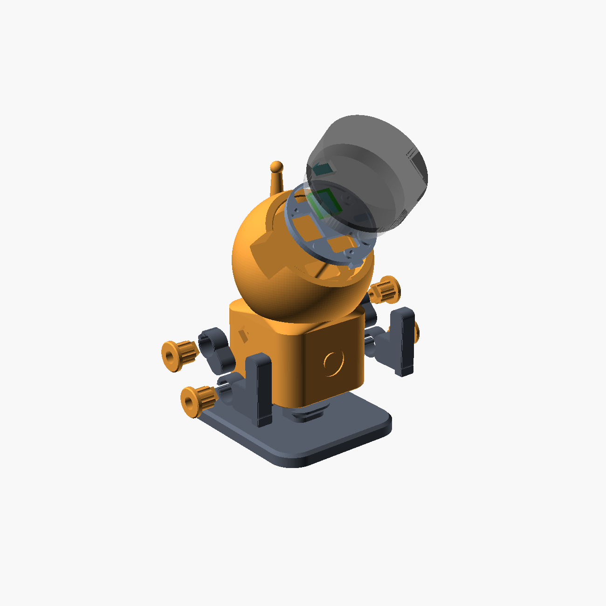

- Ball head 64 mm across, rounded-box torso, a backpack that hides the cable.
- Legs click between standing and sitting; arms click full circle in eight positions, including straight up beside the head.
- Each joint is a hub pin, a limb and one M3 screw. The limb's eye is a split ring with two teeth that click into eight notches. The teeth are rounder than the notches, so they wedge and the limb sits without play.
- Ten printed pieces, four screws, about 81 g of filament, and a body that takes roughly six hours.

It went through several rounds: a printability review that removed every overhang steeper than 40 degrees, a desk seat it clips onto, a rounder body, and arms that can go overhead. It also has a 30 minute test print for the parts that depend on unverified measurements.

It was never printed. After all that refinement the request was: *"lets ditch the articulation, i want a fast single print."*

## 3. The robot we built

The one-piece robot is in [`designs/robot-onepiece/`](../designs/robot-onepiece/).

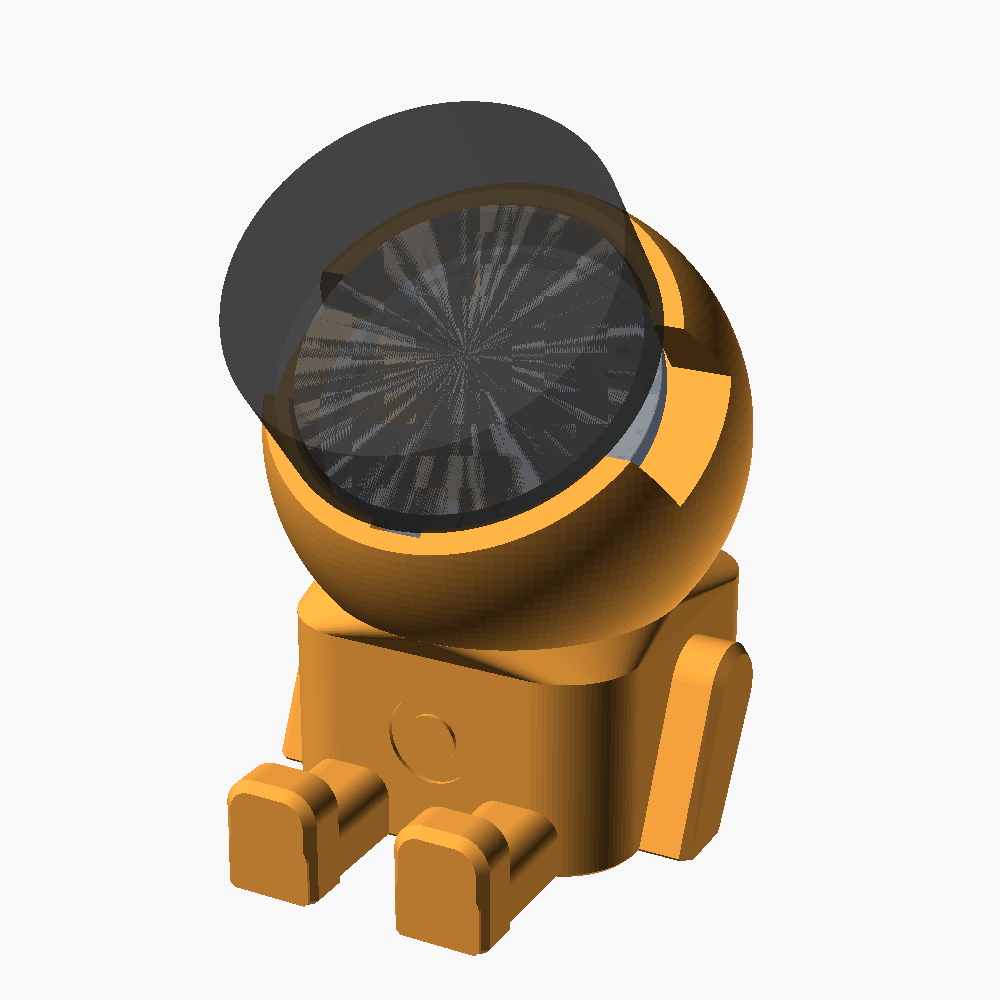

It sits with its legs forward and its hands on the desk. Nothing moves and nothing is assembled. The print job is two objects on one plate: the robot, and a small mount plate.

| | |
|---|---|
| Size | 60 x 79 mm on the bed, 77 mm tall |
| Head | 60 mm ball, face tilted up 50 degrees |
| Parts | 1 robot + 1 mount plate, printed together |
| Hardware | 3 x M1.6 x 4 screws (supplied with the display), 4 rubber feet |
| Supports | None |

### 3.1 How the display mounts

The display has nothing to grip on its body except three small threaded holes in its back. So:

1. A **mount plate** is screwed to the back of the display once, with three M1.6 screws. Their heads sink into counterbores.
2. The plate has a **lug** at the bottom. Display and plate drop into a pocket in the robot's head, and the lug falls into a keyway. That stops the display turning when you turn the knob.
3. The face looks up at 50 degrees, so **gravity** holds the display in. Two optional pairs of 6 x 2 mm magnets add a snap.
4. Two **finger slots** at the sides of the face let you pinch the display's base and lift it out. No tools.

Only the fixed base touches the print. The pocket rim stops 1.5 mm below the knob.

### 3.2 Everything risky lands on the plate

Two measurements could not be verified before printing: whether the hole pattern is mirrored correctly, and how far the knob travels when pressed. Both were put on the plate.

- Holes mirrored? Set `flip_pattern = true` and reprint the plate. The USB-C socket sits on the robot's centre line, so nothing else moves.
- Knob bottoms out on the rim? Raise `plate_t`. A thicker plate lifts the display.

The plate takes minutes to print. The robot never needs reprinting for either problem.

In the end neither switch was needed. The first plate fitted the display and the knob presses freely.

### 3.3 The cable

The USB-C plug goes up through an opening in the underside, tips forward into a channel in the head and comes out in the pocket. The cable leaves through a slot at the bottom of the backpack. The slot narrows toward the top, so pressing the cable upward grips it. That keeps tugs on the cable from reaching the display and stops the plug falling back into the head when the display is out.

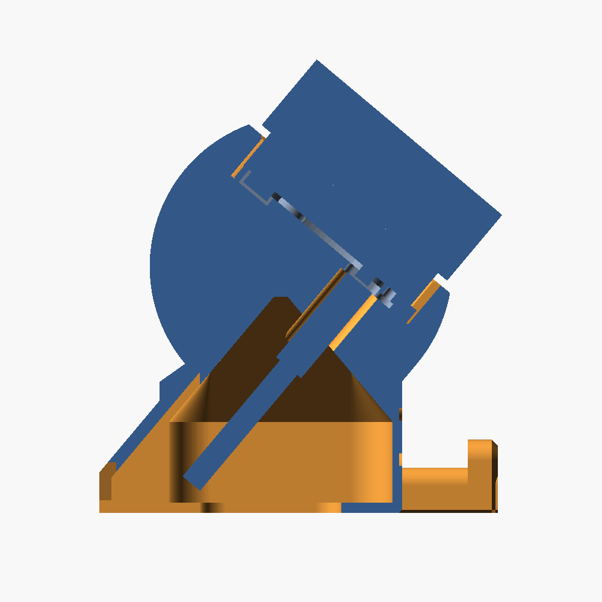

### 3.4 Designing for no supports

- **40 degree rule.** No surface overhangs by more than 40 degrees, apart from 0.6 mm bed-edge chamfers and two details a few square millimetres in size. The 50 degree face tilt was chosen so the roof of the display pocket lands exactly on that limit.
- **No flat ceilings.** The inside of the hollow torso rises at 50 degrees to meet the head, like a tent.
- **Limbs that need nothing.** The legs lie on the bed and the arms stand on it.
- **Bed-edge chamfers** stop first-layer squish from tightening the fits.

### 3.5 Will it tip when you press the knob?

A press on the knob pushes down and back along the face's 50 degree axis. That line meets the desk 41 mm behind the body's centre. The backpack reaches 40 mm back, so the press lands almost on the edge of the footprint. By calculation the robot would have to weigh under about 10 g to tip; the print alone is about 45 g.

It will slide, though. About two thirds of the press force pushes it backward, and bare plastic on a desk does not grip. Rubber feet fix that, and so does the optional [desk seat](../designs/robot-desk-seat/), which gives the robot a hard stop to push against.

### 3.6 Making it print fast

A second request followed the first: *"remove the antenna and make it print even faster."*

- The antenna pin on the head was removed. It added 11 mm of height and was the one fragile feature. `antenna = true` brings it back.
- The head went from 64 mm to 60 mm.
- The torso was lowered to 26 mm.
- Torso walls were set to 1.8 mm, which is exactly four 0.45 mm lines. The slicer prints them as plain walls with no gap fill.

## 4. Printing it

| | |
|---|---|
| Printer | Creality K1 Max with CFS, 0.4 mm nozzle, smooth PEI plate |
| Filament | Red Creality Hyper PLA |
| Slicer | Creality Print 7.3 |
| Profile | Stock "0.20mm Standard": 0.2 mm layers, 2 walls, 15 % grid infill, supports off |
| Sliced result | **1 h 26 min, 44.63 g, 14.96 m of filament, 385 layers, no warnings** |

Before slicing, the estimate from filament volume was 46 g and 1.25 to 1.75 hours. The slicer agreed.

A faster variant exists on paper only: lightning infill and 0.24 mm layers should bring it to about 39 g and a little over an hour. Sparse infill is 14 g of the 44.6 g at stock settings. That figure is a calculation, not a slicer result.

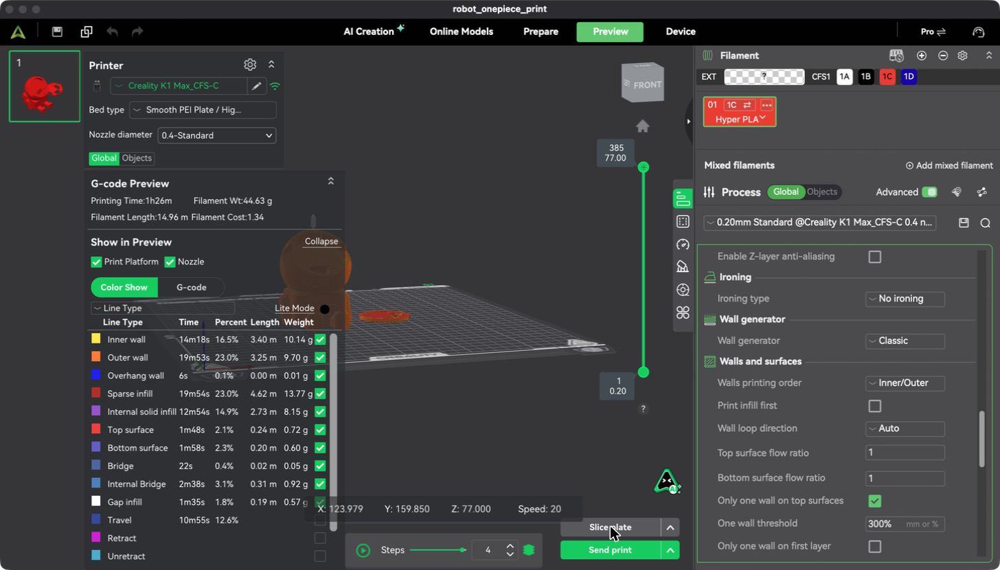

*Creality Print after slicing: 1 h 26 min, 44.63 g, 385 layers.*

### 4.1 How the AI ran the printer

The assistant operated Creality Print through its window: it checked the profile, pressed "Slice plate", read the result, and opened the "Send print" dialog. Two things went wrong on the way and both are worth telling.

- **The command-line slicer crashed.** The first attempt to get a print time used Creality Print's command-line mode. It crashed, twice, and the owner saw his slicer crash without knowing why. The assistant admitted it, stopped using that path, and from then on estimated from volume until the real app could be used.
- **The last click was not allowed.** The final "Start Print" button lives in a part of the dialog the assistant's tools refuse to click. It did not try to get around that. It prepared everything, said that nothing had been sent, and asked the owner to press the button.

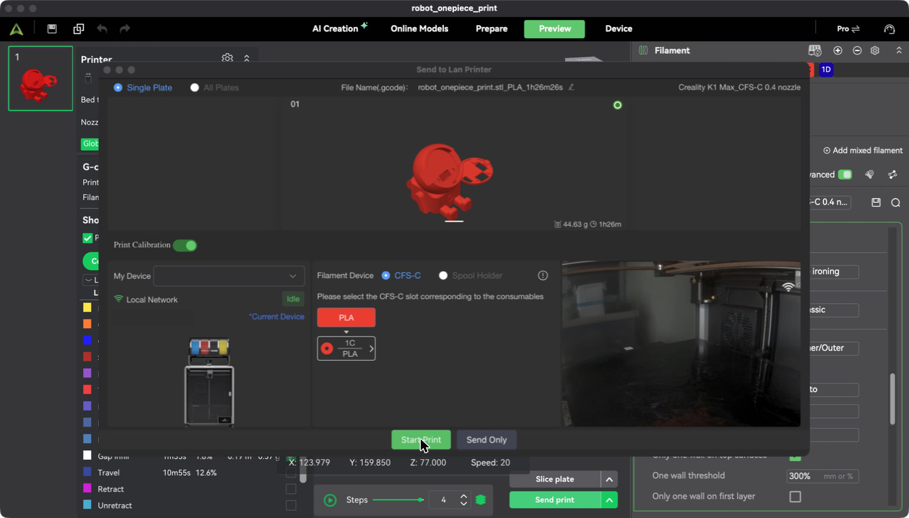

*As far as the assistant could go. The owner pressed Start Print. (The printer's network name and address are covered.)*

### 4.2 Watching the print

The owner then left, with this instruction: *"can you watch it for any issues and if the model is displaced or spagetti forms message me and we can decide to stop the print."*

So the assistant checked the printer's camera every four minutes, with one rule: if a part moved or filament started stringing, send a message and let the owner decide. It was not to stop or pause anything by itself.

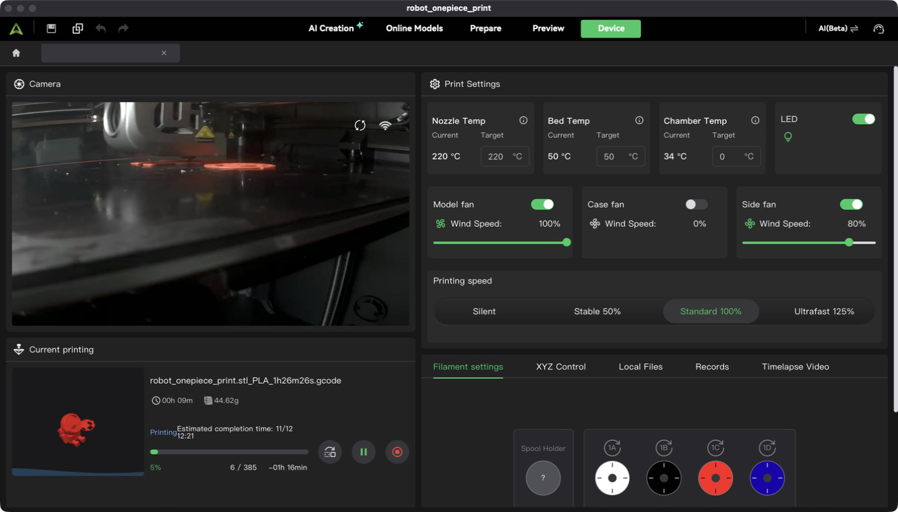

*The first look, at 11:04: layer 6 of 385, nozzle at 220 °C, bed at 50 °C, 1 h 16 min to go.*

Twenty-one checks followed, from 11:08 to 12:28. These are the actual camera views the assistant judged the print from:

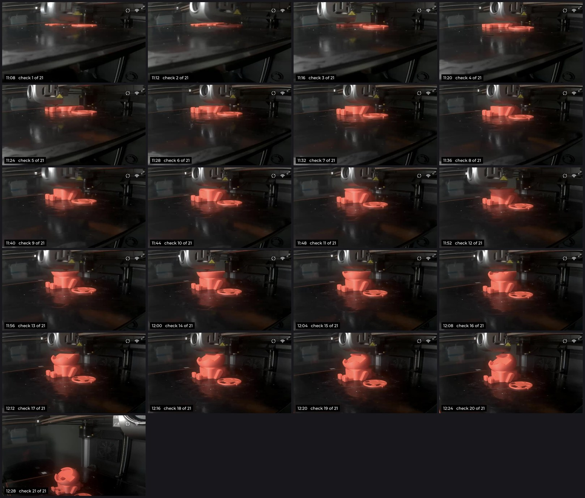

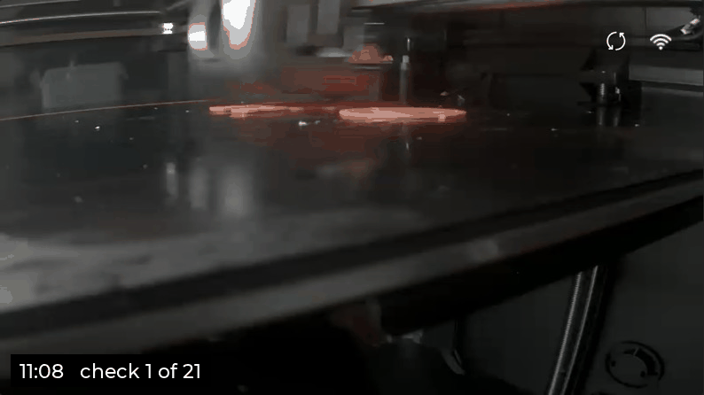

In every one, both parts were where they started, the walls were clean, and the head's overhang printed without drooping. The mount plate, lying flat beside the robot, is only 3.2 mm thick and was finished early on. At the 12:28 check the printer was idle, the bed had dropped, and the robot was standing complete. A notification went to the owner's phone.

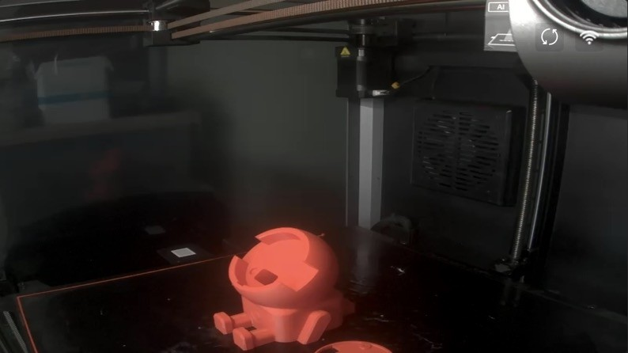

*12:28. The opening in the head is the pocket for the display; the notches are the finger slots.*

The camera is dark and low resolution, so surface quality was never judged from it. The individual frames are in [`media/print/`](media/print/).

## 5. The demo software

The display shipped running Nextion's ESPHome firmware, which asks for a Wi-Fi network. For a video, the robot needed a face. The request was: *"can we flash something that can showcase the device on a video?"*

The result is in [`firmware/onx_showcase/`](../firmware/onx_showcase/): six animated scenes, about 1,250 lines of C++ plus generated font tables.

| Scene | What the knob does | Preview |
|---|---|---|
| Hello | Robot eyes follow the turn. Spin fast and they go dizzy |  |
| Climate | Target temperature, 16 to 30 degrees | 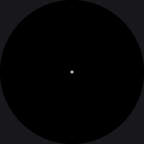 |
| Sound | Volume, with a ring of spectrum bars | 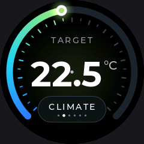 |
| Time | Winds an analogue clock, one minute per click |  |
| Colour | Picks a hue on a colour wheel | 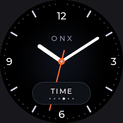 |
| Warp | Speed and direction of a star field | 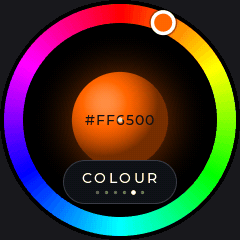 |

*The previews are rendered by the simulator described below, from the same code that runs on the device. They are not photographs.*

Controls: turn to play, press for the next scene, hold for a second to rotate the picture a quarter turn. Left alone for 15 seconds, it plays by itself and walks through every scene, which is useful for filming.

### 5.1 First, a backup

Before flashing anything, the whole 16 MB flash was read off the device. The first attempt dropped at 56 %. The second read it in sixteen 1 MB pieces with retries, each verified by checksum, and two of those needed a retry. The script is in [`firmware/tools/`](../firmware/tools/).

The backup also answered a question. Searching the factory image for text found `ili9xxx`, `rotary_encoder` and a link to Nextion's public ESPHome configuration, which names the panel (GC9A01A), every pin and the SPI speed. That agreed with the schematic.

### 5.2 Drawing without seeing the screen

The assistant cannot see the display. Graphics code written blind is usually wrong in ways only eyes catch, so the firmware was structured to make the picture checkable somewhere else.

- **The renderer is our own and portable.** `gfx.h` is a small software renderer: anti-aliased circles, arcs, lines with round ends, rounded boxes, glows and text, drawn into a plain frame buffer. It uses no display library.
- **The scenes are portable too.** `scenes.h` contains every scene and has no hardware calls in it.
- **A simulator runs the same two files on a computer** and writes frames as images. The assistant looked at those images, fixed what was wrong, and only then flashed.
- **On the device, the display library only does delivery.** LovyanGFX initialises the panel and sends finished pixels.

So what was verified on screen-sized images is, byte for byte, what the panel receives. What the simulator cannot show is how the panel renders it: colour, brightness and orientation.

Shapes are drawn from signed distance functions: for each pixel, how far is it from the edge of the shape? Coverage falls off across one pixel, which gives smooth edges at any angle. Shapes combine by taking the larger of two distances, which is how the happy eyes are made: a rounded box with a circle carved out of the bottom.

The frame buffer is 24-bit colour even though the panel is 16-bit. Soft glows drawn straight into 16-bit show visible bands. Drawing in 24-bit and dithering down on the way out hides them.

Fonts are Montserrat, rasterised to 8-bit alpha tables by a short Python script.

### 5.3 Checks the device could do itself

Since nobody could confirm things by eye in the loop, the firmware checks what it can and reports over USB:

- **Panel identity.** It reads the controller's ID register: `00 9A 01`, a GC9A01.
- **SPI speed.** The factory firmware runs the display at 40 MHz. We wanted 80 MHz. At boot the firmware writes a mode register 256 times at 80 MHz and reads the status back each time. Zero errors.
- **Refresh rate.** The panel's tearing-effect pin pulses once per refresh. Measured: 86 Hz, with a 0.73 ms vertical blank.
- **Knob resolution.** Nextion does not say how many electrical steps one click makes. The firmware learns it: a knob can only rest on a detent, so where it rests in the four-step cycle gives the answer. On this unit it is one step per click.

### 5.4 From 18 to 50 frames per second

The first build ran at 18 frames per second. Getting it to about 50 took four findings.

1. **The frame buffer was in the wrong memory.** It had landed in external PSRAM, which is several times slower than internal RAM. Allocating it first, before anything else, put it in internal RAM. To make room, the full-size 16-bit output buffer was replaced with two small strips: while one strip travels to the panel by DMA, the next is being converted. Result: 18 to 43 fps.
2. **The chip has no square root or divide instruction for floats.** Both are slow library calls. The renderer got its own fast square root and reciprocal, and the inner loops were rewritten so most pixels need neither.
3. **Glows were the hot loop.** They cover the most pixels. They now use integer maths and a lookup table.
4. **Things that never move are worked out once.** The colour wheel and the thermostat's arc are stored as lists of pixels with their coverage.

Measured on the device:

| Scene | Drawing time | Frames per second |
|---|---|---|
| Hello | 6 to 9 ms | 49 to 56 |
| Climate | 9 ms | 48 |
| Sound | 10 ms | 45 |
| Time | 9 to 11 ms | 43 to 51 |
| Colour | 9 to 12 ms | 43 to 49 |
| Warp | 10 to 13 ms | 42 to 46 |

Sending a frame takes 11.3 ms on top of the drawing time. Rates dip to about 40 during the wipe between scenes.

One subtlety: sending a frame takes almost exactly as long as the panel takes to scan one (11.3 ms against 11.7 ms). If the send starts at the wrong moment, the scan overtakes it part-way down and the picture tears. The firmware times each send to start just after the scan has set off. Whether that removes tearing completely has not been checked by eye.

### 5.5 The bug that looked like a broken knob

The first report after flashing was: *"it doesnt respond to rotations or click of the display."*

The assistant's first theory was the knob's interrupt handling, so it rewrote input to sample the pins 1,000 times a second from a small task. The knob then worked, and the theory looked confirmed.

Then: *"its stuck now."*

The log showed the truth. The firmware prints a status line over USB every three seconds. With a computer connected but no program reading, those lines pile up in a buffer. When the buffer filled, the write call waited forever, and the animation and input stopped with it. A setting meant to prevent exactly that (`setTxTimeoutMs(0)`) makes it worse on this version of the ESP32 Arduino core: a retry counter starts at zero, is decremented, and wraps round to four billion.

It had only ever worked while the assistant was reading the log. Every time it stopped reading to do something else, the device froze about 45 seconds later. The knob was never the problem.

The fix is small: a log line is sent only if all of it fits in the buffer at that moment, and is dropped otherwise. The test was to leave the device alone for 100 seconds with nothing reading and then check that it had kept running through the scenes. It had.

The first explanation given to the owner was wrong, and the correction went to him as plainly as the fix.

## 6. Did it work?

Yes. The owner's report on 17 November:

- **The plate fits the display.** The three holes lined up as printed, so the mirroring of Nextion's back-view drawing was right the second time.
- **The knob presses fine** in the head, with the 1.5 mm gap that was a guess.
- **The demo works as expected** on the real display. He has filmed it in detail.

Neither of the plate's escape hatches (`flip_pattern`, `plate_t`) was needed.

What is still unverified:

- **Colours, knob direction and tearing** have not been reported one by one; the video clips will show them. A one-line setting (`ENC_DIR`) flips the direction.
- **Surface quality** of the print was never judged from the printer's camera.
- **The stand, the puck, the posable robot and the desk seat** have never been printed.
- **The CC1101 radio wiring** has never been powered.
- **Restoring the factory firmware** from the backup has never been run.
- **The faster print settings** are a calculation.

## 7. What we would tell someone starting the same project

1. **Decide what may touch the part before drawing anything.** Here it was "only the fixed base, never the knob".
2. **Mirror anything taken from a back-view drawing.** Then assume you still got it wrong and make it cheap to flip.
3. **Put every unverified dimension on the smallest part.** The plate reprints in minutes; the robot takes an hour and a half.
4. **Design to an overhang limit, not to a support strategy.** Tilting the face until the pocket roof met the limit removed supports entirely.
5. **Fewer parts beat cleverness.** The posable robot is the better design. The one-piece robot is the one that got printed.
6. **If you cannot see the output, build something that can.** The simulator turned blind graphics code into checked graphics code.
7. **Make the device test itself.** A register echo test proved the faster SPI speed in one boot.
8. **Never let firmware wait for a listener.** A debug print froze the product.
9. **When the fix works, check that it worked for the reason you think.**

## Credits and sources

- Hardware facts: Nextion's dimension drawing and schematic for the ONX2424G013, and their public ESPHome example, <https://github.com/opennextion/OpenNextion-Example-ESPHome_KNOB_Control>.
- Display driver on the device: LovyanGFX.
- Typeface: Montserrat, SIL Open Font License.
- CAD: OpenSCAD. Slicer: Creality Print 7.3.
- Design, firmware and print supervision were done with Claude Code.
