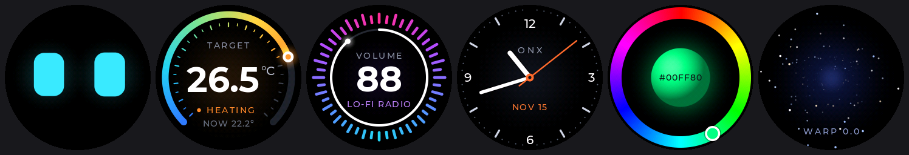

# Firmware for the ONX2424G013

| Folder | What it is |
|---|---|
| `onx_showcase/` | Demo firmware: six animated scenes driven by the knob |
| `tools/` | Scripts to back up the factory firmware before flashing, and to restore it |



*Rendered by the simulator from the firmware's own drawing code.*

**Back up first.** Flashing replaces the firmware the display shipped with. `tools/backup_factory.sh` reads the whole flash to a file.

## Showcase demo
- **Turn the knob:** play with the current scene.
- **Press:** next scene.
- **Hold for one second:** turn the picture a quarter turn. The setting is remembered. The board has no motion sensor, so this is the only way to orient it.
- **Leave it alone for 15 seconds:** it plays by itself and walks through all the scenes. Any touch takes control back.

| Scene | Knob does |
|---|---|
| Hello | Robot eyes follow the turn. Spin it fast and they go dizzy |
| Climate | Sets the target temperature, 16 to 30 degrees |
| Sound | Volume, with a ring of spectrum bars |
| Time | Analogue clock. The knob winds the time a minute per click |
| Colour | Picks a hue on the colour wheel |
| Warp | Star field. The knob changes speed and direction |

The clock starts from the time the firmware was built. It has no network or battery clock, so it restarts from that time at every power-up.

### Build and flash
Needs `arduino-cli` with the `esp32:esp32` core (3.3.6 used) and the LovyanGFX library (1.2.21 used).

```bash
./onx_showcase/build.sh flash
```

Without `flash` it only compiles. The upload needs no button presses.

### Hardware facts used
From Nextion's schematic and their public ESPHome configuration for this board. More in [`../docs/HARDWARE.md`](../docs/HARDWARE.md).

| Function | GPIO |
|---|---|
| LCD (GC9A01A, SPI): MOSI, CS, DC, SCLK, RST | 1, 2, 3, 5, 8 |
| LCD backlight (high = on), tearing-effect output | 6, 7 |
| Knob press (low = pressed) | 9 |
| Encoder A, B | 48, 47 |

ESP32-S3 with 16 MB flash and 8 MB octal PSRAM. One encoder click is one quadrature transition; the firmware learns this by itself and stores it.

### Measured on the device (2026-11-15)
- Panel answers as a GC9A01 (ID `00 9A 01`).
- SPI at 80 MHz: 256 register writes read back with no errors. The factory firmware uses 40 MHz.
- About 40 to 55 frames per second depending on the scene (lowest during the wipe between scenes). Panel refresh is 86 Hz.
- Knob steps and presses arrive (seen in the serial log while the device was being used).

Not checked by me, because I cannot see the screen: colours, which way is up, and whether clockwise counts up. If clockwise is backwards, set `ENC_DIR` to `-1` in `onx_showcase.ino`.

### How it is put together
- `gfx.h`: a small anti-aliased software renderer. It draws into a 24-bit frame buffer and dithers down to the panel's 16 bits, which keeps glows and gradients smooth.
- `scenes.h`: the six scenes and the switching between them.
- `onx_showcase.ino`: display, knob, button and timing.
- `sim/`: runs the same scene code on a computer and writes frames as images, for checking the graphics without the hardware.
- `tools/make_media.py`: turns simulator output into the PNG sheets and GIFs in `docs/media/`.
- `tools/make_fonts.py`: regenerates `fonts.h` from Montserrat (SIL Open Font License).

Serial log at 115200 baud on the USB port: a status line every three seconds, plus knob and key events. Log lines are dropped when nothing is reading them, so the animation never waits for a computer.

## Factory firmware
The display ships with Nextion's ESPHome build (1.0.0 on our unit), the one that asks for a Wi-Fi network. That image is not in this repository.

```bash
./tools/backup_factory.sh my_backup
```

reads all 16 MB in 1 MB pieces with retries, because a single long read dropped part-way for us.

```bash
./tools/restore_factory.sh my_backup/factory_full_16MB.bin
```

writes it back. We have not tried the restore.

## Previews and the simulator
```bash
python3 onx_showcase/tools/make_media.py ../docs/media
```

builds the simulator and regenerates the stills and GIFs. To get an image sequence of one scene for video work:

```bash
cd onx_showcase/sim && c++ -O2 -std=c++17 -I.. sim.cpp -o sim && ./sim frames out_dir 0 10 30
```

That is scene 0 (Hello), 10 seconds, 30 frames per second, as PPM files in an existing `out_dir`.

## A warning for anyone changing this firmware
Do not call `Serial.print` directly. On the ESP32-S3's USB serial port a print waits for the computer once its buffer is full, and with nothing reading it the animation and the knob stop. Use `logf()` in `onx_showcase.ino`, which drops the line instead. The story is in [`../docs/ARTICLE.md`](../docs/ARTICLE.md), section 5.5.
